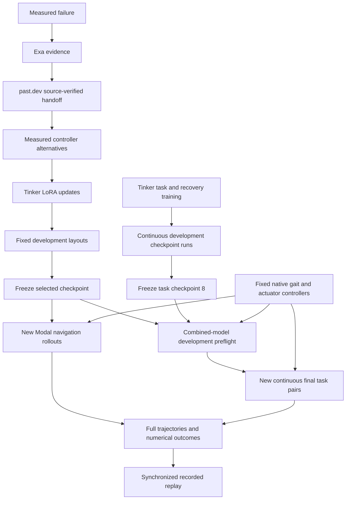

# Navigation and contact control, continuation study V25

This study continues the V23 navigation experiment and V24 task preflight. V23's selected model did not beat its strongest fixed strategy. V24 completed the clock, drawer and laptop, then made an unintended wrist contact on its approach to the globe.

The new navigation comparison asks whether a post-trained selector can preserve the fixed strategy's qualified completions while reducing measured steps on fresh layouts. The physical gait network is fixed. Tinker updates rank-16 LoRA weights in Qwen3.5-4B, which selects a route and controller profile from privileged geometry.

## Shared controller repairs

The first twelve V25 pilot attempts failed physical qualification. Holding the arms at their recovered targets disrupted the pretrained whole-body walking controller. A matched training-geometry diagnosis restored native arm commands and passed the same route, including its unchanged foot-clearance check. This repair is shared by the parent, trained models and all conventional controls.

The new action set separates speed from clearance: direct, buffered, and a wide-clearance fast option. Every compared method receives the same options, planner, observations and physical controller. The earlier native ONNX weights, contact rules, success checks and archived results remain intact.

The physical source freeze covers 240 files. The failed arm-masked implementation is archived separately. An execution-only amendment reloads shared artifact storage before cache checks and permits local training data collection through the identical evaluator. Training records retain CPU architecture and actual provider. Final checkpoint comparisons execute together on Modal.

## Navigation data and selection

The geometry-only generator sealed 40 training layouts, eight development layouts and eight final navigation layouts before training. It moves the printer and mug, changes blocked corridors and target heading, and rejects invalid static geometry. It does not filter scenes using model performance. A new scene combines its obstacle arrangement and target pose; a repeated physics seed is not a new layout.

Each training label comes from all three profiles executed under both physics seeds. A label requires qualification under both seeds. The teacher first preserves physical quality, then minimizes steps and time. Layouts without a qualified candidate remain in the evidence without a fabricated successful label. Fixed and contextual controls use every measured training interaction, including those unlabeled layouts.

Tinker minibatches balance measured winner classes and may emphasize failures within a class. Exa supplies research evidence for that allocation; a design decision reads the evidence through past.dev before choosing the replay allocation. This is an actual workflow dependency, not proof that search or memory improves navigation.

Checkpoints are compared on the same development cohort. The final cohort opens only after checkpoint selection. The predeclared goal requires no newly failed fixed-strategy successes, at least five percent lower mean paired-layout step count, no more than five percent slower completion, improvement on at least four layouts, and no falls or forbidden contacts.

Efficiency includes only attempts where both methods qualify. Seeds are grouped within layout. Reported uncertainty resamples layouts, not individual episodes. A short failed route never counts as an efficiency gain. If no checkpoint satisfies the development gate, final layouts remain unopened.

## Four-task engineering

The continuous task sequence is clock, drawer, laptop close, then globe rotation, including book ascent, a turnaround and forward-facing descent. Task success still requires real contact, release, supported recovery and the original numerical checks. The physical base is free.

The globe approach needed more departure space beside the laptop. A new task scene moves both the globe and its base five centimetres east at reset. Moving the base alone is not a valid assembly relocation; those unsuccessful component attempts are retained. The new approach keeps its final heading through a bounded actuator-driven alignment.

One uninterrupted development run completed all four tasks without a fall or forbidden contact. Its globe-leg median moving-foot clearance was 4.477 mm, below the frozen 4.5 mm limit, so the run failed full quality qualification. The accepted engineering revision approaches the globe facing east and uses contact-gated sole-height feedback through bounded joint actuators. Its reference is 9 mm during turns and 7 mm during straight approach. It preserves horizontal foot position in the inverse-kinematics correction and applies no physical-base forces or hidden supports.

The repaired sequence qualified in 752 measured steps and 326.97 seconds on the original development reset. That is a shared controller repair, not a Tinker training result. A second physics seed fell during book descent. Matched descent probes then compared three timing profiles from clone-verified post-turn states. Slightly slower support transfer qualified on both seeds without adding descent steps. The resulting uninterrupted second-seed sequence qualified in 870 steps and 345.20 seconds. A separate task-development arrangement also qualified, in 878 steps and 346.58 seconds. These three development successes do not establish performance on unopened task layouts.

The task comparison freezes this later shared implementation before the first task optimizer update. Task selection first checks matched component alternatives, then executes all four checkpoints from reset on the same continuous development scenario. Only that full-sequence comparison selects the checkpoint for the sealed final task layouts. If the navigation study has not passed its gate, task-model comparisons use the same training-selected fixed navigation wrapper and report that limitation.

Component alternatives branch only from physically reached states. A clone check verifies that a restored state produces the same next physical step. These branches supply contact and recovery training examples. Full-sequence evidence always comes from a new uninterrupted attempt from reset.

## Evidence and limits

Exact measurements, rejected candidates, trajectories and optimizer receipts remain in Mochi artifact storage. past.dev stores compact, source-linked findings with explicit writer identities and audience controls. Dependent reads wait for ingestion and require the expected source ID. A synthetic private canary checks isolation.

No final-layout outcome may become a training label. No engineering change is attributed to weight training. This study does not establish visual perception, low-level gait learning, hardware transfer, a robotics benchmark record or a causal memory advantage.

## Compact continuation

The three-profile study was stopped before update 33. Updates 8 and 16 failed the reliability gate on the full development cohort. An additional physical update-32 test also failed a fixed-qualified clearance case, making that checkpoint ineligible regardless of its remaining outcomes. Its full development cohort was not completed and no aggregate result is invented for it. Original weights, partial evaluations and the targeted failure are retained.

The remaining sixteen navigation updates use the two existing direct and buffered controllers. This is a new decision interface, shared by its parent and trained models. Planner summaries replace redundant raw obstacle and waypoint lists: path length, clearance, turns, speed and explicitly qualified timing proxies. A static five-millimetre clearance band is a geometric feature. No development outcome, teacher label, split identifier or fitted control rule enters the observation.

Eight additional training layouts were executed under both seeds and both retained controllers, adding 32 real physical attempts. The original 24 layouts are retargeted using their already measured direct/buffered alternatives. The resulting 32-layout corpus has 26 direct and six buffered robust teacher choices. The next updates resume the saved update-32 weights and optimizer. Checkpoints zero, 32, 40 and 48 share the compact representation, separating representation effects from further weight updates.

Navigation makes one discrete choice before physics advances. Development therefore uses the complete physical direct/buffered outcome table for the same eight layouts and two seeds. Two independently executed duplicate cases matched exactly in trajectory, controls, step events and balance samples. Lookup-based checkpoint evaluation is labeled as such and does not count as a new rollout. Every final comparison requires a new uninterrupted physical execution. The tuned two-profile rule is a separate control, not an observation or an undisclosed safety filter.

The new protocol and source freeze precede all compact optimizer updates. Its budget uses the original shared ledger: 32 original navigation updates, sixteen task updates, and at most sixteen compact navigation updates, totaling 64. The task adapter is frozen at development-selected update eight. Once compact navigation selection is frozen, its final navigation and task cohorts may execute concurrently under the same three-Modal/two-local physics cap. Neither final cohort supplies training labels or changes checkpoint selection.

The combined models first execute the task development arrangement together. The selected combination must qualify before any final task layout is opened. The parent integration attempt is retained too. Task-final execution uses named sampler copies of the frozen optimizer checkpoints. Copies expire after one day; canonical optimizer states remain available. A sampling timeout may use Tinker's read-only `forward` API to score the same answer tokens, with no backward pass or optimizer step. A paired diagnostic reproduced an earlier sampler distribution within 4.97e-8. This is an inference fallback, not additional training.

Model and API waits pause simulation time. Displayed completion times are simulated physical time and exclude those waits. Wall time and inference latency are recorded separately. This study does not establish a real-time hardware control system.

### Task-controller integration revisions

The initial combined-model development preflight completed all four tasks but failed the unchanged per-leg clearance check. No final task layout was opened. R2 and all of its frozen sources remain intact. R3 applies the existing sole-pad residual to drawer and laptop transits. One reached-state laptop test arrived but measured 4.064 mm median moving clearance, so it was rejected. R4's larger targets measured 5.786 mm but failed to capture the target pose within 45 simulated seconds. Its arrival timeout is retained. Neither is a successful repair.

R5 tests an intermediate residual: 10 mm turn and 8.5 mm straight swing-pad targets, bounded vertical errors of 5/4 mm, joint offsets of 0.14/0.12 radians and reference rates of 2.5/2.25 radians per second. Contact gating requires support from the other foot. Original actuator force limits remain active. The existing globe residual is retained. The native gait, base dynamics and physical verifiers remain fixed.

The local reached-state probes screen this engineering candidate. A fresh complete development preflight on Modal is required before assuming it works under the remote CPU runtime. Both parent and selected models share that implementation and runtime. The preflight uses one task worker alongside the three navigation workers. Final task execution waits until navigation and the local capture have ended, then reallocates the same five-worker ceiling to task rollouts. This is a controller-engineering comparison around frozen trained selectors, not additional optimizer training.



## Setup and reproduction

Run commands from the repository root. Reuse the existing environment when available. The continuation pins its provider SDKs separately because the original project's optional dependency versions predate this study.

```sh
uv venv --python 3.11 mochi/.venv
uv pip install --python mochi/.venv/bin/python torch==2.15.0 --index-url https://download.pytorch.org/whl/cpu
uv pip install --python mochi/.venv/bin/python -r mochi/configs/continuation-v25/runtime-requirements.txt
mochi/.venv/bin/python mochi/scripts/restore_navigation_v23_assets.py
PYTHONPATH=mochi/src mochi/.venv/bin/python -m pytest mochi/tests/test_navigation_v25_checks.py mochi/tests/test_navigation_tasks_v24_frames.py -q
```

To reproduce a fixed navigation attempt without provider credentials:

```sh
PYTHONPATH=mochi/src OPENBLAS_NUM_THREADS=1 OMP_NUM_THREADS=1 mochi/.venv/bin/python - <<'PY'
import json
from pathlib import Path
from mochi.navigation_v25.engine import run
layout=json.loads(Path('mochi/configs/continuation-v25/development.json').read_text())[0]
result=run(layout,251000,'buffered',record=False)
print({k:result[k] for k in ['qualified','checks','steps','physical_seconds','failure']})
PY
```

The same source is available through `navigation_v25.tasks.run` for a fixed four-task attempt using `tasks/development.json`. These are physical controller reproductions, not new learned-model results. CPU architecture is recorded because numerical differences can affect contacts.

The authenticated study uses `scripts/train_navigation_v25.py`, `scripts/train_tasks_v25.py` and `scripts/evaluate_task_checkpoints_v25.py`. Original optimizer states and raw trajectories remain in the owner's Modal and Tinker storage. Reproducing the exact learned parent requires that access. New campaigns must use new identities, isolated service names, fresh final sets and a new budget ledger. Do not overwrite the archived campaign or rerun a final set as if it were unopened.

Sponsor paths are explicit: Tinker optimizer and sampling calls are in the two training scripts; the shared physical worker and budget broker are in `src/mochi/navigation_v25/remote.py`; the existing source-verified Exa and past.dev adapter is `src/mochi/navigation_v23/services.py`. The public replay is deployed by `scripts/deploy_continuation_v25.py`; it serves only whitelisted, hash-checked recordings and contains no service keys.
